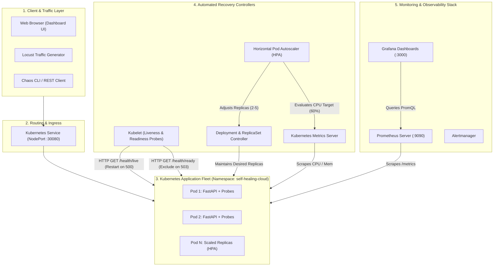

# Architecture Documentation: Self-Healing Cloud Infrastructure Platform

## 1. System Overview

The **Self-Healing Cloud Infrastructure Platform** is a cloud-native platform designed to maintain continuous application availability, automatically detect and recover unhealthy containers, and dynamically scale workloads in response to unpredictable traffic spikes.

---

## 2. Core Architectural Pillars

### A. Two-Tier Health Probing Architecture
Kubernetes distinguishes between whether an application process is alive vs ready to serve traffic:
- **Liveness Probe (`/health/live`):**
  - **Interval:** Evaluated every 5 seconds.
  - **Action:** If the endpoint returns non-200 responses for 3 consecutive attempts, Kubelet terminates the container process and spawns a fresh container instance.
  - **Cloud Concept:** Automatic recovery from thread deadlocks, memory leaks, and fatal runtime hangs.
- **Readiness Probe (`/health/ready`):**
  - **Interval:** Evaluated every 4 seconds.
  - **Action:** If the endpoint returns HTTP 503, the Kubernetes endpoints controller immediately removes the pod IP from the Service endpoint list.
  - **Cloud Concept:** Graceful degradation, warmup handling, and zero-downtime traffic isolation during transient faults.

### B. Deployment & ReplicaSet Reconciliation Loop
The Kubernetes controller manager runs a reconciliation loop:
$$\text{Reconciliation Error} = \text{Desired Replicas} - \text{Current Healthy Replicas}$$
If a pod crashes or is terminated:
1. State disparity is detected within milliseconds.
2. The ReplicaSet controller schedules a replacement pod on available nodes.
3. The replacement pod completes initialization and passes readiness checks.
4. The service begins routing traffic to the replacement pod.

### C. Horizontal Pod Autoscaler (HPA) Dynamics
The HPA scales pod replicas based on CPU utilization:
- **Target:** 60% average CPU utilization across pods.
- **Min Replicas:** 2 (guarantees high availability).
- **Max Replicas:** 5 (safeguards local resources).
- **Scale-Up Policy:** Immediate response to traffic bursts (0s stabilization window).
- **Scale-Down Policy:** 60-second stabilization window to prevent flapping.

---

## 3. Data & Metric Flow

1. **Instrumentation:** Application uses the Prometheus Python client to track latency histograms (`http_request_duration_seconds`), total requests (`http_requests_total`), and fault states.
2. **Collection:** Prometheus server scrapes application pods at `/metrics` every 10 seconds.
3. **Visualization:** Grafana queries Prometheus via PromQL and presents operational KPIs, latency quantiles (P50/P95), and pod health states.
4. **Local Dashboard:** The embedded dashboard polls `/api/system/cluster` and `/api/system/metrics` to render real-time pod statuses and allow one-click chaos testing.
